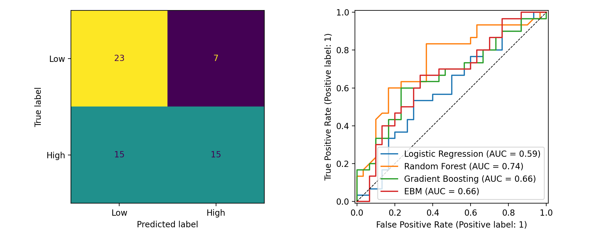

# Smallholder Farmer Resilience Capacity: Explainable Boosting Machine

Predicts whether a Sri Lankan smallholder farmer has **High or Low resilience capacity** from socio-economic, challenge, and risk-management survey data, and explains each prediction.

- **Live app:** `https://farmer-resilience-ebm-laksana.streamlit.app/

## Data
Mendeley Data, *Challenges and Resilience Capacities of Smallholder Farmers in Sri Lanka* (raw survey data, 300 farmers). Public, anonymized survey data; no personal identifiers.

## Method
- **Algorithm:** Explainable Boosting Machine.
- **Split:** 80/20 stratified train/test (240 train, 60 test). Hyperparameters tuned with 5-fold cross-validation on the training set only.
- **Hyperparameter grid** (CV AUC, mean ± sd):

| Interactions | Learning rate | CV AUC |
|---|---|---|
| 0 | 0.01 | **0.624 ± 0.053** |
| 0 | 0.05 | 0.618 ± 0.054 |
| 5 | 0.01 | 0.614 ± 0.082 |
| 5 | 0.05 | 0.623 ± 0.081 |

- **Baselines:** Logistic Regression, Random Forest, Gradient Boosting.
- **Metrics:** Accuracy, macro F1, AUC.

## Results

### Test set (n = 60)
| Model | Accuracy | F1 (macro) | AUC |
|---|---|---|---|
| Logistic Regression | 0.600 | 0.598 | 0.592 |
| Random Forest | **0.667** | **0.666** | **0.742** |
| Gradient Boosting | **0.667** | 0.663 | 0.659 |
| **EBM** | 0.633 | 0.627 | 0.659 |

### 5-fold cross-validation (training set, mean ± sd)
| Model | Accuracy | F1 (macro) | AUC |
|---|---|---|---|
| Logistic Regression | 0.537 ± 0.061 | 0.535 ± 0.060 | 0.548 ± 0.058 |
| Random Forest | 0.646 ± 0.068 | 0.642 ± 0.067 | 0.658 ± 0.068 |
| Gradient Boosting | 0.571 ± 0.068 | 0.566 ± 0.066 | 0.604 ± 0.068 |
| **EBM** | 0.592 ± 0.064 | 0.589 ± 0.065 | 0.624 ± 0.053 |

### Bootstrap 95% confidence intervals (test set)
| Model | Accuracy 95% CI | AUC 95% CI |
|---|---|---|
| Logistic Regression | 0.47 to 0.72 | 0.44 to 0.73 |
| Random Forest | 0.55 to 0.78 | 0.62 to 0.87 |
| Gradient Boosting | 0.55 to 0.78 | 0.52 to 0.79 |
| **EBM** | 0.52 to 0.75 | 0.52 to 0.78 |

### EBM per-class report (test set)
| Class | Precision | Recall | F1 | Support |
|---|---|---|---|---|
| Low | 0.605 | 0.767 | 0.676 | 30 |
| High | 0.682 | 0.500 | 0.577 | 30 |




## Limitations
- Small dataset (300 farmers, 60 in the test set) and a modest signal; results have wide uncertainty.

## Run the app locally
```
pip install -r requirements.txt
streamlit run app.py
```